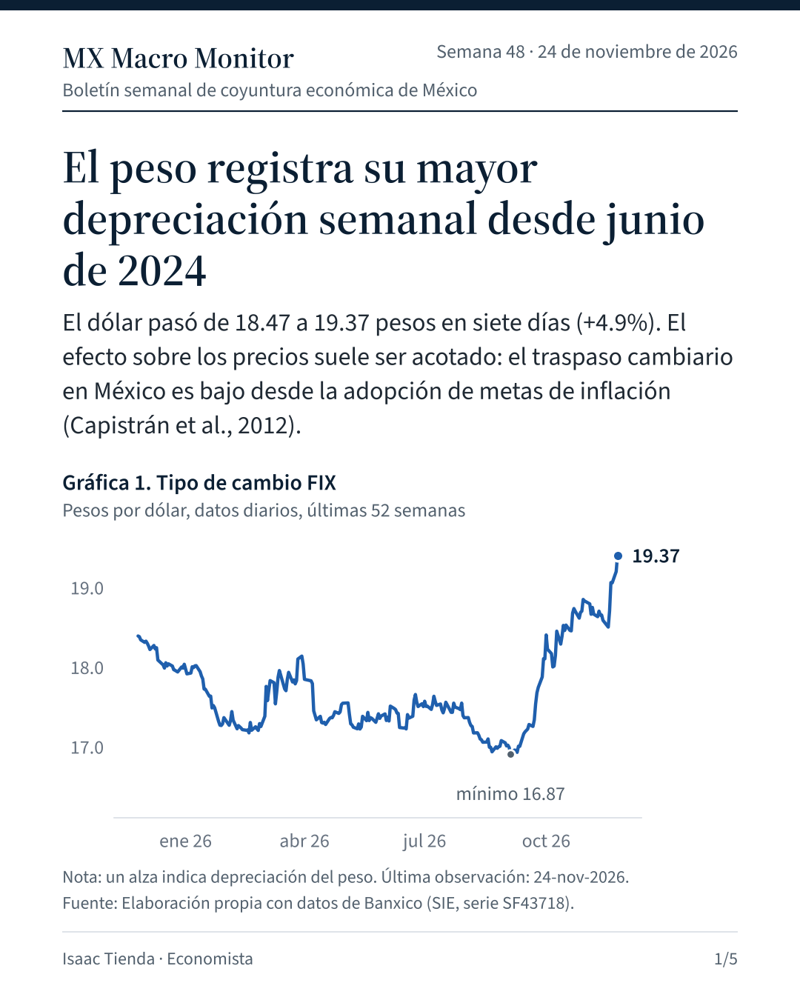

# MX Macro Monitor

Pipeline en Python que cada lunes descarga series oficiales de **Banxico (SIE)**, **INEGI (BIE)** y la **Reserva Federal (FRED)**, calcula variaciones y señales estadísticas, redacta una lectura económica en español e inglés y genera un **boletín de LinkedIn en formato institucional (PDF 4:5, 5 páginas)** listo para publicar, con respaldo académico, fuentes trazables y una nota firmada del autor.

<p align="center"></p>

## Qué produce cada lunes (07:00 h, centro de México)

| Archivo | Uso |
| :--- | :--- |
| `bulletins/carousel_es.pdf` / `carousel_en.pdf` | Documento para LinkedIn: gráfica de la semana, indicadores clave, segunda gráfica, lectura del autor + agenda, notas y referencias |
| `config/nota_autor.yml` | Nota firmada de la semana (la escribe el autor; si no corresponde a la semana en curso, el boletín sale sin ella) |
| `bulletins/linkedin_post.md` | Texto del post en español, primer comentario en inglés y checklist de publicación |
| `bulletins/latest_es.md` / `latest_en.md` | Boletín de una página (también en `bulletins/archive/`) |
| `data/latest.json`, `data/history.csv` | Snapshot de la semana e historial de cada corrida |
| `data/raw/*.csv` | Caché de las series descargadas: permite reconstruir y auditar cualquier semana |

Las láminas en PNG se adjuntan como *artifact* de cada corrida de GitHub Actions (90 días).

## Indicadores

| Bloque | Serie | Fuente | Clave |
| :--- | :--- | :--- | :---: |
| Inflación | Inflación general anual | INEGI vía Banxico SIE | `SP30578` |
| | Inflación subyacente anual | INEGI vía Banxico SIE | `SP74662` |
| | Expectativa de inflación 12 meses, general y subyacente (mediana) | Encuesta Banxico | `SR14195`, `SR14202` |
| | Expectativa de inflación 12 meses, media (base de la tasa real ex ante) | Encuesta Banxico | `SR14194` |
| Política monetaria | Tasa objetivo | Banxico SIE | `SF61745` |
| | Rango de fondos federales, límite superior | Fed vía FRED | `DFEDTARU` |
| Tipo de cambio | FIX | Banxico SIE | `SF43718` |
| Actividad | IGAE, serie desestacionalizada (2018=100) | INEGI BIE | `737219` |

Derivados: tasa real ex ante (tasa objetivo − media de expectativas a 12 meses, definición de Banxico) comparada con el rango neutral estimado por Banxico (1.8%–3.6%), tasa real ex post, diferencial Banxico–Fed, variación semanal / mensual / anual del FIX, rango de 52 semanas y promedio móvil de 3 meses del IGAE.

## Metodología

- **Señal estadística.** Puntaje z del último cambio frente a la ventana previa (60 meses; 260 semanas para el FIX). El dato más reciente **no** entra en su propia media ni desviación estándar. *Inusual* si |z| ≥ 1.5; *atípico* si |z| ≥ 2.
- **Variaciones calendario.** Los datos diarios se comparan contra la observación hábil más cercana anterior (`asof`) a 7 días, 1 mes y 12 meses.
- **Tasa en puntos base.** Los cambios de tasa y del diferencial se reportan en pb, no en porcentaje.
- **Lectura automática.** `src/narrative.py` redacta cada frase a partir del snapshot con reglas explícitas: describe dirección y magnitud, no atribuye causas que los datos no muestran. El titular se elige por valor noticioso (decisión de Banxico reciente > señal atípica del tipo de cambio > dato de inflación o IGAE publicado en la semana).
- **Agenda.** `config/agenda.yml` contiene los calendarios oficiales de INEGI, Banxico y la Fed; el pipeline avisa en el log cuando la cobertura queda a menos de 30 días.
- **Degradación controlada.** Si una fuente falla, se usa la última versión en caché y se declara en el boletín; solo se detiene la publicación si faltan inflación, tasa o tipo de cambio.
- **Diseño:** ver [`docs/DESIGN_SYSTEM.md`](docs/DESIGN_SYSTEM.md) (tokens, tipografía, reglas de gráficas sin cuadrícula, plantillas y auditoría v2 → v3).

## Referencias

- Banco de México (2024). Actualización de la estimación de la tasa neutral en México. *Informe Trimestral abril–junio 2024*, Recuadro 7.
- Capistrán, C., Ibarra, R. y Ramos-Francia, M. (2012). El traspaso de movimientos del tipo de cambio a los precios: un análisis para la economía mexicana. *El Trimestre Económico*, 79(316), 813–838.
- Ángeles, D., Cortés, J. F. y Sámano, D. (2019). Evolution and Characteristics of the Exchange Rate Pass-Through to Prices in Mexico. Banco de México, Working Paper 2019-10.
- Fama, E. F. (1984). Forward and spot exchange rates. *Journal of Monetary Economics*, 14(3), 319–338.
- Heath, J. (2012). *Lo que indican los indicadores*. INEGI.

## Instalación local

```bash
pip install -r requirements.txt
cp .env.example .env            # agrega tus tokens gratuitos de Banxico e INEGI
python src/macro_monitor.py     # descarga y genera todo
python src/macro_monitor.py --offline   # reconstruye desde data/raw sin tokens
python -m pytest -q tests
```

Tokens: [Banxico SIE](https://www.banxico.org.mx/SieAPIRest/service/v1/token) · [INEGI](https://www.inegi.org.mx/app/api/indicadores/interna_v1_1/tokenVerify.aspx). En GitHub, guárdalos como `BANXICO_TOKEN` e `INEGI_TOKEN` en *Settings → Secrets and variables → Actions*.

## Estructura

```
src/
  config.py       catálogo de series, umbrales y rutas
  sources.py      clientes Banxico / INEGI / FRED + caché CSV
  analytics.py    métricas y señales (snapshot)
  narrative.py    lectura en ES/EN, titular, texto del post
  agenda.py       próximos eventos y publicaciones recientes
  carousel.py     render del carrusel 1080×1350 (PDF + PNG)
  macro_monitor.py  orquestador
config/agenda.yml   calendario oficial de publicaciones
docs/PLAYBOOK.md    rutina semanal de publicación en LinkedIn
docs/DESIGN_SYSTEM.md  sistema de diseño (tokens, gráficas, redacción, auditoría)
tests/              pruebas de regresión
```

## Cambios de la versión 2 (auditoría de noviembre de 2026)

- **IGAE corregido:** la serie `737121` corresponde a cifras originales; se reemplazó por la desestacionalizada `737219`. La versión anterior reportaba −2.16% mensual para septiembre de 2026; INEGI publicó −0.7%.
- La fila de inflación ahora muestra la tasa anual (3.75%) y no el nivel del índice.
- El puntaje z excluye el dato evaluado y usa umbrales de 1.5σ / 2σ (antes 1σ, que por construcción marcaba ~32% de los meses).
- Nuevos indicadores: subyacente, expectativas, tasa real ex ante, diferencial con la Fed y agenda.
- Formato LinkedIn 4:5 en carrusel PDF; lectura interpretativa; historial y caché de datos; pruebas automáticas.

---

### English summary

Weekly Python pipeline pulling official Mexican macro data (Banxico SIE, INEGI BIE) and the Fed funds target (FRED). It computes changes and out-of-sample z-score signals, writes a rule-based bilingual reading backed by academic references, and renders a 5-slide 4:5 LinkedIn carousel (PDF) plus post copy every Monday via GitHub Actions. Run `python src/macro_monitor.py --offline` to rebuild any week from the committed data cache.

**Autor:** Isaac Tienda · Economista
